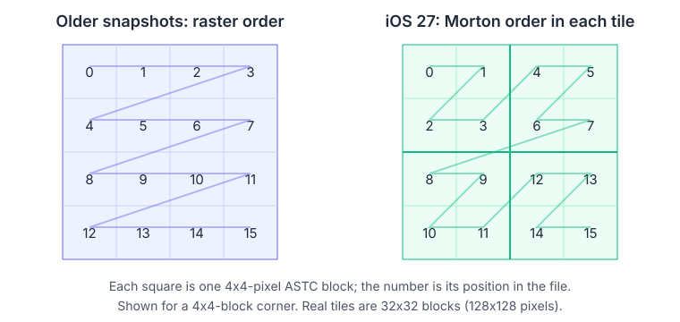

# iOS 27 App Snapshots and the Tiled KTX Layout

App snapshots are the images iOS keeps of an app's screen for the app switcher and for the launch transition. iLEAPP has parsed them for years in the **App Snapshots** artifact, converting Apple's KTX files to PNG so they can be viewed in the report and in LAVA.

On a full file system extraction of an iPhone on iOS 27.2, all 324 of them were wrong. Some were horizontal streaks of colour. More than half were a single flat colour, which is worse: they looked like plain launch screens, and nothing on the page said they had failed.

A note on versions before going further: iOS 27.2 is simply the only iOS 27 extraction we had. The change could have arrived with iOS 27.0 or any release since, and we have no 27.0 or 27.1 files to say which. Where this post says "iOS 27.2", read it as "the version we tested", not "the version that changed".

This post covers what was going on, what Apple changed, and how iLEAPP now handles it. The fix is [abrignoni/iLEAPP#2887](https://github.com/abrignoni/iLEAPP/pull/2887).

## Where the snapshots live

Nothing moved. The App Snapshots artifact looks in the same places it always has:

```text
*/Library/Caches/Snapshots/*.ktx
*/SplashBoard/Snapshots/*.ktx
*/mobile/Library/FrontBoard/applicationState.db
```

On the iOS 27.2 extraction the files are under `Library/SplashBoard/Snapshots/sceneID:<bundle id>-default/`, each with a `downscaled/` copy, which is the same shape as iOS 17 and 18. The seeker found all of them and the artifact reported every row. Only the pictures were broken.

## A quick refresher on the format

Despite the `.ktx` extension, these are not Khronos KTX files. They start with an Apple magic, `AAPL\r\n\x1a\n`, followed by a run of chunks, each a 4-byte little-endian length and a 4-byte tag:

| chunk | holds |
| --- | --- |
| `HEAD` | the texture description: format, base format, width, height and further fields |
| `FILL` | padding |
| `astc` / `LZFS` | the texture data, raw or LZFSE-compressed |
| `END ` | end marker |

The texture data is ASTC with 4x4-pixel blocks (`glInternalFormat` 0x93B0). Every block is 16 bytes and describes one 4x4 square of pixels, so a 1170x2532 screenshot is 293 x 633 = 185,469 blocks. To make a PNG, iLEAPP hands those blocks to an ASTC decoder and asks for an image of that width and height.

The decoder assumes the blocks are in **raster order**: the first row of blocks left to right, then the second row, and so on. That was true of every snapshot we had looked at before.

Comparing an iOS 27.2 snapshot with the iOS 17 ones, the magic, the `HEAD` layout, the format value and the image sizes are all the same. The chunk list is not:

| | iOS 17 (compared) | iOS 27.2 |
| --- | --- | --- |
| chunks | `HEAD`, `FILL`, `LZFS`, `END ` | `HEAD`, `FILL`, `astc`, `END ` |
| texture data | LZFSE-compressed | uncompressed |
| `FILL` size | 136 bytes | 16,264 bytes |
| texture data starts at | 0x100 | 0x4000 |
| typical file size | a few KB | about 3.2 MB |

None of that broke anything. iLEAPP's reader already accepted both an `LZFS` and an uncompressed `astc` chunk, so it read the iOS 27.2 files without an error, decompressed nothing, and passed the blocks to the decoder. What it could not know was that the blocks were in a new order.

## What changed: the blocks are tiled

Two things gave it away.

**There are too many blocks.** A 1170x2532 snapshot on iOS 27.2 holds 204,801 blocks, not 185,469. 204,800 is exactly 320 x 640, which is the image rounded up to a whole number of 32-block tiles in each direction (293 → 320, 633 → 640), and then there is one extra block on the end. Every snapshot in the extraction followed the same rule, portrait and landscape. On three older extractions the block count matched the image exactly, every time.

**A second decoder disagreed about the "blank" ones.** iLEAPP's decoder rendered 193 of the 324 files as one flat colour. Running the same bytes through [texture2ddecoder](https://github.com/K0lb3/texture2ddecoder), an independent ASTC decoder, gave streaky images with rows of decoder error blocks instead. A truly blank screenshot would be flat in both. The data was not empty; it was out of order.

Trying a few common GPU layouts settled it. The blocks are stored in **tiles of 32x32 blocks** (128x128 pixels). Tiles run left to right, top to bottom, across the padded surface. Inside each tile, the 1,024 blocks are in **Morton order**, also called Z-order, where the bits of the x and y block positions are interleaved:



Morton order keeps blocks that are close together on screen close together in memory, which is how GPUs like to read textures. It is a common layout for GPU textures; we have not seen Apple document it for these files. What is described here was worked out from the files themselves.

## How iLEAPP handles it now

The reader that all of this goes through is `KTX_reader` in [`scripts/ktx/ios_ktx2png.py`](https://github.com/charpy4n6/iLEAPP/blob/72ad64d485cdc403947934b9dcd756b9083d2487/scripts/ktx/ios_ktx2png.py#L198), originally written by Yogesh Khatri. It now has one new step, `untile_astc_4x4`, which runs on the texture data of every `AAPL` file before it goes to the decoder:

1. Work out the block grid from the image size (293 x 633 for a 1170x2532 snapshot), and the padded grid rounded up to whole 32-block tiles (320 x 640).
2. If the file holds fewer blocks than the padded grid needs, return the data as it is. This is the old layout.
3. Otherwise, walk the image block by block in raster order. For each block, find its tile from `x // 32` and `y // 32`, find its place inside the tile by interleaving the bits of `x % 32` and `y % 32`, and copy that block into the output.

The output is in plain raster order with exactly one block per 4x4 pixels, which is what the decoder has always expected. Nothing after that point changed.

### The old layout still works

This was a hard requirement: snapshots from iOS 17 and 18 should come out exactly as they did before. Because the decision is made from the block count, an older file never reaches the reordering code. The reader returns the very same bytes it was given, and a test checks for that. Standard Khronos KTX files go through a separate path that was not touched.

### One case the block count cannot decide

If an image happened to be an exact multiple of 128 pixels in both directions, the padded and unpadded block counts would be the same, and the size alone would not say which layout it is. For that case only, the reader looks at the 13th 32-bit word of the `HEAD` chunk. It was 1 in every tiled file we have and 0 in every older file. We do not know what Apple calls that field or what else might set it, so it is used as a tie-breaker and nothing more. No real snapshot we have needed it; this path is covered by a synthetic test.

## Results

Every file was decoded twice, once by iLEAPP and once by texture2ddecoder, and the two outputs compared:

| extraction | snapshots | layout | result |
| --- | --- | --- | --- |
| iOS 27.2 | 324 | tiled | no decoder error blocks; both decoders agree |
| iOS 17 | 106 | raster | unchanged; both decoders agree |
| older iOS extraction | 262 | raster | unchanged; both decoders agree |

Widget snapshots (`com.apple.chrono/snapshot-cache`) use the same reader, so they were checked too: 41 across the three extractions, including 24 on iOS 27.2. All of them are still in raster order, so the widget artifact was never affected.

The Messages preview cache artifact shares the reader as well and gets the same handling. We had no tiled Messages previews to test against, so that path is unexercised.

One more thing about those 193 flat images. After the fix, they are still a single colour, and now both decoders agree. They are real plain launch and placeholder screens; the earlier disagreement between decoders came from the scrambled order, not from the content. If you see plain white or black snapshots in a report, that is what the device stored.

## What examiners should take from this

- If you processed an iOS 27 extraction with an iLEAPP build from before this change, the App Snapshots images in that report are not usable. The rows, paths and dates are fine. Re-run the artifact with a build that includes the fix to get the pictures.
- A flat image is not proof that a decode failed, and it is not proof that it worked. The second-decoder check is what told the two apart here.
- Snapshots are still what they always were: an image iOS saved of an app's screen. An app can hide or replace its content before the snapshot is taken, so a snapshot does not by itself show that someone viewed what is in it.

## What we have not covered

- We have one iOS 27 device, on iOS 27.2. We do not know which iOS 27 release introduced the tiled layout, and other models, screen sizes and releases may differ.
- The Messages preview cache path is untested on tiled data.
- The meaning of the `HEAD` field used as the tie-breaker is not established.

If you have iOS 27 extractions where App Snapshots still look wrong after this change, or examples of tiled files outside SplashBoard, please open an issue on [iLEAPP](https://github.com/abrignoni/iLEAPP/issues). Counts and file shapes are enough to start; we do not need the images themselves.
