# LEAPPs: AI-assisted verification & validation at scale

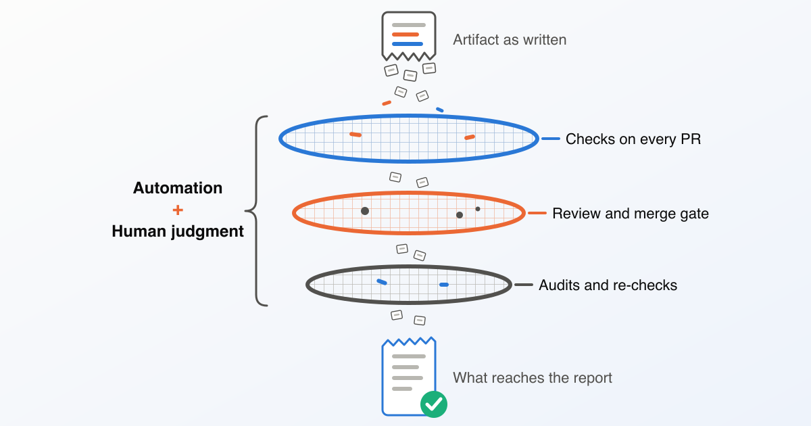

Every artifact in the LEAPPs ends up in someone's report. The description and notes go into the HTML report and the [LAVA](https://leapps.org/releases#section-lava) manifest, and examiners quote them in casework and in court. If a notes sentence says a table holds "all searches" and it holds the last ten, that is a false statement in someone else's report, with my tool's name on it.

So I have built a set of checks around artifact work. These are key. Verification and validation at scale are necessary in order to keep up with automated artifact generation and analysis. No layer is trusted alone: each checks the one before it, and the last feeds work back to the first. This post follows a piece of work through all of them, so you can copy what helps your own tool. Everything here is built as of 26 November 2026.

Much of it runs on my own Mac, against a private corpus, with AI agents doing a lot of the reading. I will say where a model is involved and where a person decides.

The tools that run outside the LEAPP repositories are public in [leapps-org/leapp-quality-kit](https://github.com/leapps-org/leapp-quality-kit) (the kit, from here on), with my account, repositories and corpus paths moved into one config file. The copy I run every day is a checkout of it.

| Where | What |
|---|---|
| Each LEAPP core | The `check_*.py` scripts and `validate_sample_data.py` in `admin/scripts/`, the test-case harness in `admin/test/scripts/`, the synced `leapp-new-artifact` skill |
| `leapps-org/leapps-parity` | The canonical copy of the `leapp-new-artifact` skill |
| `leapps-org/leapp-quality-kit` | `review-gate/`, `mac-pr-reviewer/` (the five cores' route), `notes-audit/`, `number-recheck/`, `unread-columns/`, `auditor-spot-check/`, `schema-watch/`, `agents/leapp-notes-auditor.md`, `deploy/` |
| `abrignoni/known-data-logger` | The [Known-data logger](https://leapps.org/device-tools#section-kdl) app |
| The `audit-queue` label in each core | The public part of the work queue |
| Only on my Mac | The Mac reviewer's route for the apps, probes, readers and website, its private inbox delivery, the corpus and its registries, the private queue list |

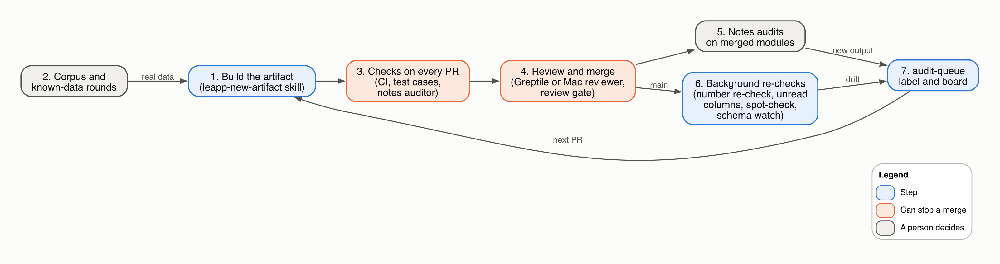

*Figure 1. The pipeline. The colours mean the same thing in every diagram, and each diagram's legend lists the ones it uses.*

## 1. Building the artifact

Artifact work follows a skill: a written procedure, `leapp-new-artifact`, that an agent or a person follows step by step. The canonical copy lives in `leapps-parity` and is synced into all five cores. The field reference for the metadata block is `admin/docs/artifact_info_block.md` in [iLEAPP](https://leapps.org/releases#section-ileapp).

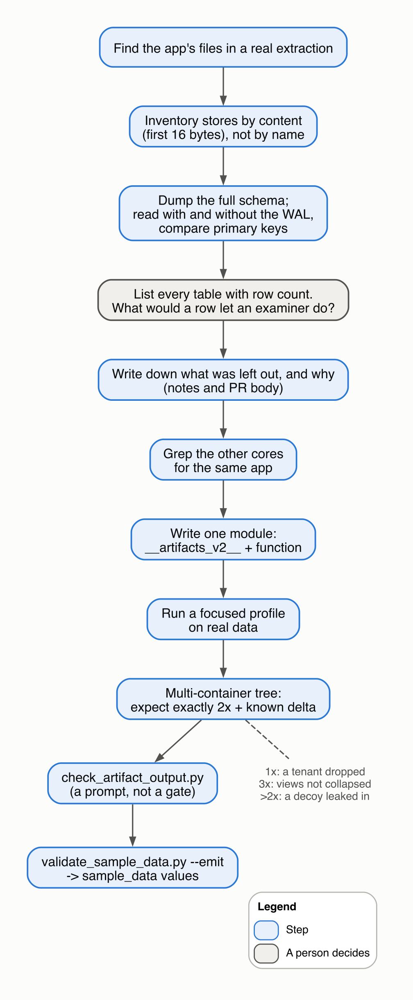

*Figure 2. The build steps, in the order the skill asks for them.*

**Find the data first.** Start from a real extraction, not the app's documentation or another tool's output. Identify stores by their first sixteen bytes, because many Android SQLite files have no extension. Dump the full schema, and read each database with and without its write-ahead log; if the two differ, the sidecar files belong in the artifact's paths.

**Decide what to report, and record what you left out.** List every table with its row count and sort by what a row would let an examiner do. Write down the tables you skipped and why, in the notes and the PR body.

**Check the siblings.** Grep the other cores for the same app first.

**Write the module.** One file under `scripts/artifacts/`, with an `__artifacts_v2__` block whose key matches the function name. Watch the fields most often wrong: `paths` (stock `fnmatch`, where `*` crosses `/`), an unversioned `author`, a `category` from the agreed list, and in [DLEAPP](https://leapps.org/releases#section-dleapp), `platforms`. The third return value is the source path, and it must be real paths, because the framework turns it into the report's "located at" line.

**Run it against real data.** Check row counts, columns and timestamp epochs on a real image. Then run one multi-container test: the same app under two folder spellings (must collapse to one), a second Android user (must add exactly its rows) and a decoy package (must add nothing). Twice plus the known extra rows is right; anything else is a bug.

**Let a script read the report.** `check_artifact_output.py` flags columns that are always empty, always the same, or copies of another column. It is a prompt, not a gate. When the blank is a real result, a notes sentence naming the column says so. The skill also has an optional step to run the kit's unread-column list here (section 6).

**Record what you measured.** Each artifact's `sample_data` lists the corpus images it was run on and the rows each gave. `validate_sample_data.py --emit` produces those lines from a finished run and flags every zero for a person to confirm. Before the PR, re-derive every number in the text from that run, label each claim as proven, sourced or untested, and say what the module does not do.

> **For examiners.** The `sample_data` lines tell you which images an artifact was run against and how many rows each gave. A notes sentence that names a column and says it was empty is a measured result on the images it names.

## 2. The corpus and known data

My corpus lives on one drive. A catalog file at its root, `corpus-roots.json`, points to one `samples.json` registry per collection: Android, iOS, desktop, drones, IoT, returns, a filesystem known-data set, and vehicles.

As of 27 November 2026 the registries list 686 corpus keys:

| Collection | Keys | Breakdown |
|---|---:|---|
| Filesystem known data | 276 | Linux 198, Windows 43, macOS 35 |
| Desktop | 224 | Windows 136, Linux 62, macOS 25, ChromeOS 1 |
| Android | 98 | Android extractions |
| iOS | 38 | iOS extractions |
| Vehicles | 38 | Vehicle head units |
| IoT | 10 | IP cameras 4, smart TVs 2, smart display, smart plug, video doorbell, Wi-Fi chime |
| Drones | 2 | 1 aircraft, 1 iOS controller |

The filesystem known-data keys are small disk images built to test the filesystem readers, each with a manifest of what was written into it when it was made. The rest are device extractions and desktop images, and most of those have no record of what was done on the device.

Much of that corpus starts with public images: CTF challenges, published test images and other evidence files the community has shared. Kevin Pagano gathers those in one place, with their hashes and passwords, in [The Evidence Locker](https://theevidencelocker.github.io/). If you are building a test set for your own tool, start there.

Each registry entry holds a key, the file and its SHA-256, the platform and versions, and four privacy fields: whether the content is private, whether it may become a test fixture, whether the key and row counts may be named in public, and who decided that. A key and a count can be public while the content never is, and `validate_sample_data.py` refuses a cited key whose public metadata is not allowed.

**Known data** has a narrow meaning here: data whose making was recorded at the time. For the filesystem images that record is the manifest. For a device or app capture it is an action log, where each action was written down with its time as I did it, before the extraction. An image without such a record, which is most public images, is observed data. It shows what is present, not what the user did to produce it. **Known-data rounds** answer "does the artifact report what the log says was done?" I run them by hand.

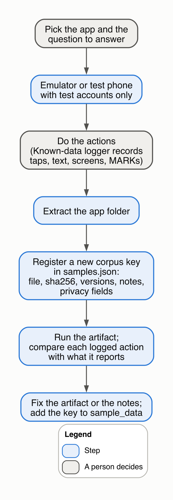

*Figure 3. A known-data round, from the question to a new `sample_data` line.*

On an emulator or test phone with test accounts, I do the actions while the Known-data logger app (`abrignoni/known-data-logger`) records taps, typed text and screens, each with its time, in a hash-chained log. Then I extract the app folder, register it as a new key, run the artifact and compare each logged action with the report. In [ALEAPP](https://leapps.org/releases#section-aleapp) #2124, on one capture of Private Photo Vault 7.6.2 (`emu_a16_ppv_known_20261126`), favouriting a photo set its favourite date and left its favourite flag at 0, so the Favourite column was blank until the fix. That result is stated for that capture and that version, not as a rule for the app.

> **For examiners.** The line is the action log, not the image. A notes sentence that says doing something set a value has to trace back to a logged action on a named capture, and it holds only as far as that log goes: two actions with no capture between them do not say which one set a value. Notes about an image with no log say what is present and on which image, never what the user did. An empty field on such an image is a measured result for that image, but it does not show that the action never happened.

## 3. Checks on every PR

Once a PR is open, the repository's own checks run. This is ALEAPP; the other cores are close to it.

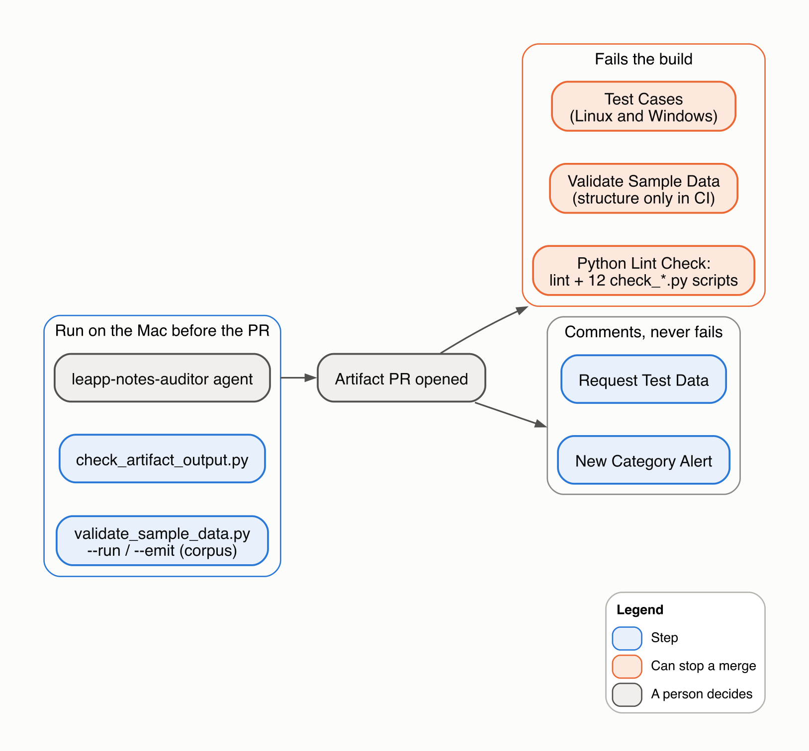

*Figure 4. What fails the build, what only comments, and what runs on the Mac before the PR.*

**Python Lint Check** runs lint plus twelve checkers. They catch examiner text that claims more than the data shows, descriptions that are missing or repeat the name, the examiner's own folder paths leaking into report rows, a source path that is not a real path, functions that return nothing, unescaped evidence in HTML columns, a staged copy's file time shown as evidence, and vendored code that drifted.

**Two checks only comment:** New Category Alert, for a category not on the agreed list, and Request Test Data, for a module changed without test data. **Validate Sample Data** checks the shape of `sample_data` in CI; the row counts need the private corpus, so they run on the Mac.

**Test Cases** reruns every committed test case on Linux and Windows and compares the rows with the recorded baseline. A deliberate change re-records the baseline in the same PR, so the reviewer sees the row diff next to the code.

**The notes auditor.** Before the PR, the `leapp-notes-auditor` agent (in the kit) reads the code and the run output, never the author's summary. It splits the description, notes and headers into single claims, marks each as proven by data, sourced, or unsupported, and returns keep, soften or remove. What it could not check is listed apart and never counted as a finding.

> **For examiners.** The claim-language and source-path checks exist so the description you read does not promise more than the data shows, and so the "located at" line in the report points at the evidence, not at someone's laptop.

## 4. Review and merge

Two reviewers cover the LEAPP PRs. **Greptile** is a hosted AI code-review service: it reads each pull request against the rest of the repository and posts its findings as review comments on GitHub. It reviews my own PRs in iLEAPP, ALEAPP, [RLEAPP](https://leapps.org/releases#section-rleapp) and [VLEAPP](https://leapps.org/releases#section-vleapp). **The Mac PR reviewer** is a review job I run on my own Mac: a model reviews the PR, and checks against the private corpus run locally, so the corpus never leaves the machine. It covers contributor PRs in the five cores, my own DLEAPP PRs, and every PR in [GLEAPP](https://leapps.org/releases#section-gleapp) and the probe and reader repositories. Every five minutes it runs the Codex command-line client in a macOS sandbox, with the PR passed as data, not instructions, posts shareable findings on the PR and keeps the full report private.

**The merge bar** is written down. A finding blocks a merge only if:

- unchanged evidence gives wrong or missing output in a normal ingest, re-run or relink;
- one bad read loses a file with no record;
- damaged evidence is presented as good; or
- it can delete the only good copy, write outside the case or output folder, modify evidence, or put a false statement in a report or status.

Anything below the bar gets one follow-up issue and a reply, and no new push, because every push starts another review round.

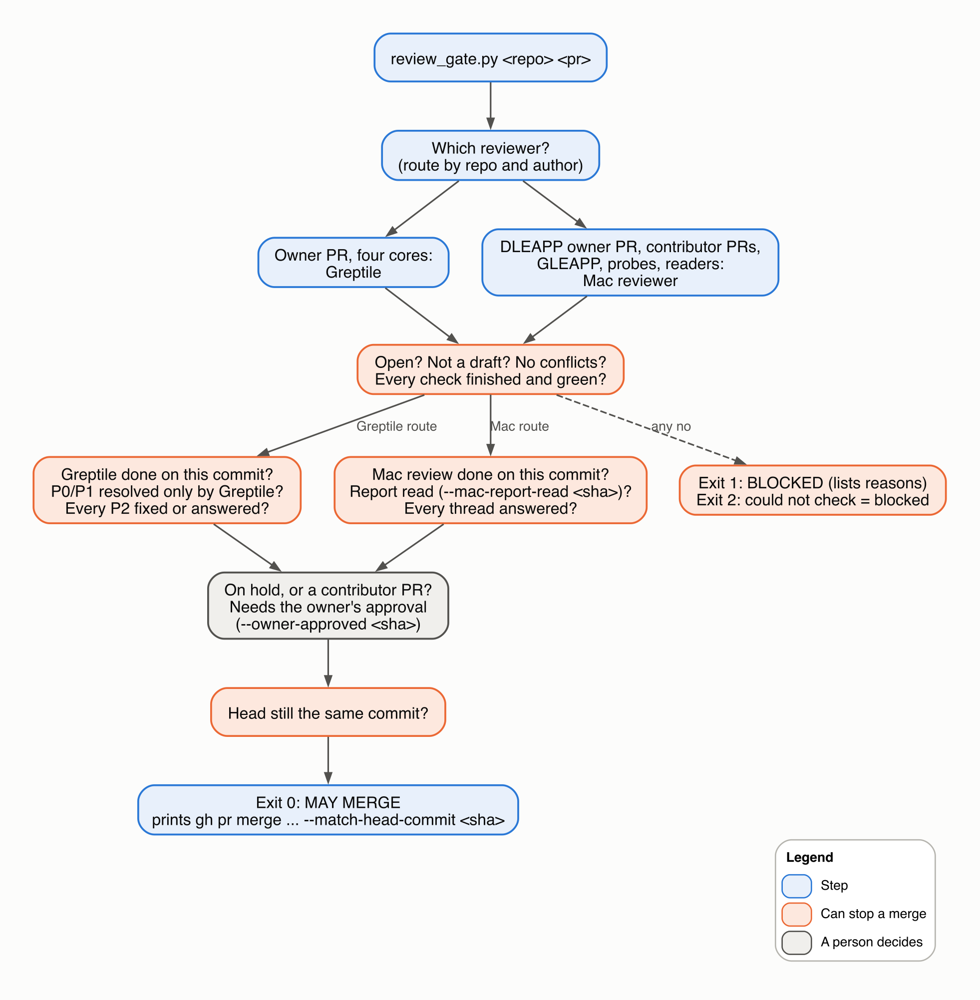

*Figure 5. What `review_gate.py` checks before it prints a merge command.*

**The gate.** `review_gate.py` only reads. It blocks if the PR is not ready, a check failed or is still running, the reviewer has not finished on this exact commit, a serious thread was closed by anyone but the reviewer, or a finding has no fix or reply. A private Mac report has to be read and acknowledged for that commit, and holds and contributor PRs need my approval. When everything passes, it prints a merge command pinned to the head commit.

**Waiting and guarding.** `wait_gate.py` reruns the gate every five minutes after a push and exits when there is something to act on, using no model tokens. A Claude Code hook, `merge_guard.py`, refuses any merge the gate has not passed, and refuses when it cannot tell. The kit's own PRs go through the same gate.

> **For examiners.** "Merged" here means CI passed, an independent review finished on that exact commit, every review thread was answered or closed by the reviewer itself, and a person read the full report where there is one. Whether each fix was right is what the next layers check.

## 5. Notes audits on merged modules

iLEAPP's first commit is from December 2019 and ALEAPP's from February 2020: more than six years of artifacts, most written by hand, by me and by contributors, with the checks we had then. ALEAPP alone has more than 600 artifact files and iLEAPP more than 500. Audit rounds go back over that work with the kit and bring older modules up to the bar new ones must meet. When the same problem shows up in many modules, the aim is to turn it into a check that runs on every PR.

An audit is not a one-time stamp. A module can need another one because:

- **the code moves**: later PRs, or a shared reader or helper, change what it returns;
- **the app moves**: a new version renames a table or records a value differently, as in the photo vault example;
- **the corpus grows**: a sentence true on every image we had can fail on the next one;
- **the bar rises**: new checks catch what old ones passed;
- **the counts go stale**: the number re-check found merged modules whose recorded counts no longer match main.

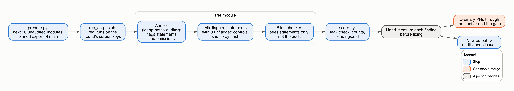

*Figure 6. One audit round: an auditor per module, then a blind checker per module.*

A round (`notes-audit/` in the kit) takes the next ten unaudited modules at a pinned commit and runs them on their corpus images. The auditor agent flags each wrong statement and each omission, quoting the text exactly. A second agent, the blind checker, then grades only the flagged sentences, shuffled in with three the auditor did not flag. It never sees the audit. A scoring script checks the blind agents' reads for leaks and writes the findings.

The blind step matters. In the pilot, a checker that could see the auditor's reasoning agreed with 51 of 58 flags: agreement, not a check. The unflagged controls show whether the blind checker is just rejecting everything.

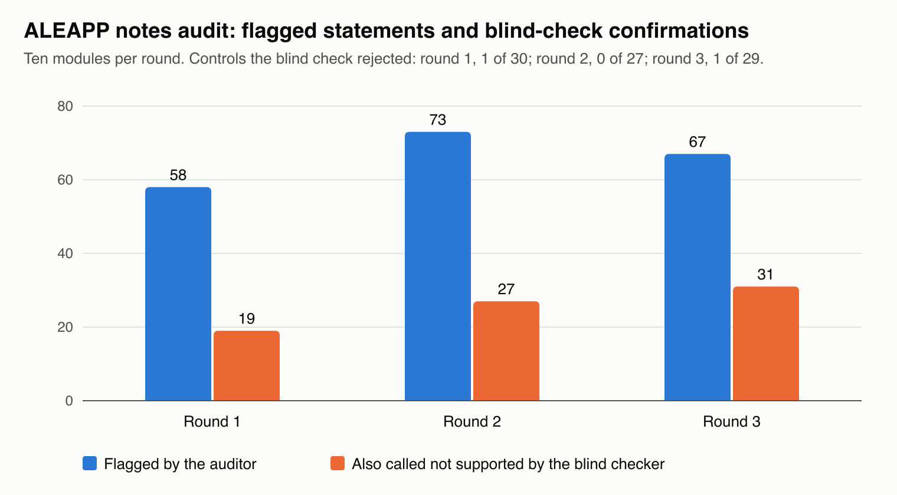

*Figure 7. Flagged statements and blind-check confirmations, three ALEAPP rounds of ten modules each.*

| Round | Flagged | Blind check: not supported | Controls rejected |
|---|---:|---:|---:|
| 1 | 58 | 19 | 1 of 30 |
| 2 | 73 | 27 | 0 of 27 |
| 3 | 67 | 31 | 1 of 29 |

A round of ten modules took about 20 agents and ten minutes. A person measures each finding by hand before anything changes, because a suggested rewording can be wrong too. Fixes go through ordinary PRs and the gate: for round 3, five code fixes and ten wording PRs. Values a store holds that no artifact reports become queue items for me to decide on.

> **For examiners.** Thirty ALEAPP modules have been through this so far, so most artifacts you use today have not been audited this way yet. That is not a reason to distrust them. It is the reason the rounds exist.

## 6. Re-checks and watches

These four run beside the per-PR path. They follow four rules: nothing new blocks a merge below the existing bar; checks that need the corpus run on the Mac, not in CI; they measure and file issues but never edit code; and they are plain scripts with no model, so tokens are spent only when someone works an issue.

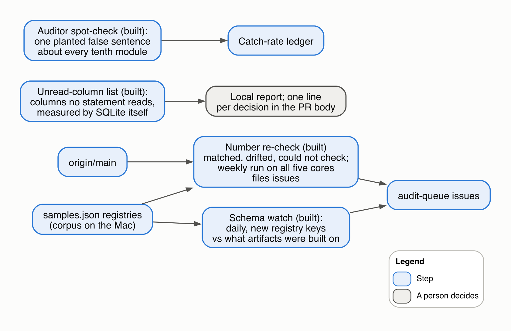

*Figure 8. What each layer reads and where its result goes.*

**Number re-check.** `number-recheck/recheck.py` reruns every corpus key a core cites in `sample_data` against a clean copy of `origin/main` and sorts each key into matched, drifted or could not check. "Could not check" is never a pass: it means an artifact hit a database error or a capability was off, so the count says more about the tool than about the evidence. Before trusting it, I raised one declared count from 1 to 8 in a throwaway copy, and it reported the drift. A launch agent runs it every Sunday for all five cores and files one `audit-queue` issue per drifted module, skipping modules that already have one open. The first ALEAPP run checked 95 keys: 61 matched, 6 drifted and 28 could not be checked.

**Unread-column list.** `unread-columns/unread_columns.py` runs during the corpus run an artifact PR already gets. SQLite itself reports every column each statement reads, so no SQL is parsed. The tool then lists the columns of each store that nothing read, with counts only. The person working the PR decides what to do with each one (skip it with a reason, build it as stored, or ask me) and records one line per decision in the PR body.

**Auditor spot-check.** `auditor-spot-check/spotcheck.py` checks the checker. About one module in ten, chosen by a hash so nobody can pick it, gets a copy with one false sentence planted in its notes. A fresh auditor reads the copy, and the result (caught or missed) goes into a ledger that becomes the auditor's catch rate. The first four plants were all caught, alongside one control run with nothing planted. That shows the loop runs end to end; four runs are not a rate yet.

**Schema watch.** `schema-watch/schema_watch.py` runs every morning. For each new corpus key it lists the table, column and preference names of the app stores an artifact reads, compares them with the keys that artifact cites in `sample_data`, and files an issue when a store gains a name or loses one the module's code uses. Its first ALEAPP run found three changed modules on one new emulator key.

> **For examiners.** These layers notice when something that was true at merge stops being true: a count, a schema, or the auditor's own accuracy.

## 7. The work queue

Everything that needs a decision lands in one place.

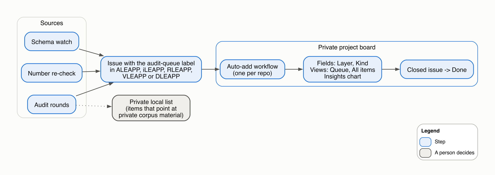

*Figure 9. How an item reaches the board.*

Each of the five cores has an `audit-queue` label. (GLEAPP is left out on purpose; it does not work with artifacts the way the cores do.) Labelled issues are added automatically to a private GitHub project board with two views, Queue and All items, and two fields: Layer (which part of the system found it) and Kind (wrong output, wording, new output, or a check to run). A chart counts what is open, and closing an issue moves it to Done. Issues filed by a script arrive with Layer and Kind blank, so I set those by hand.

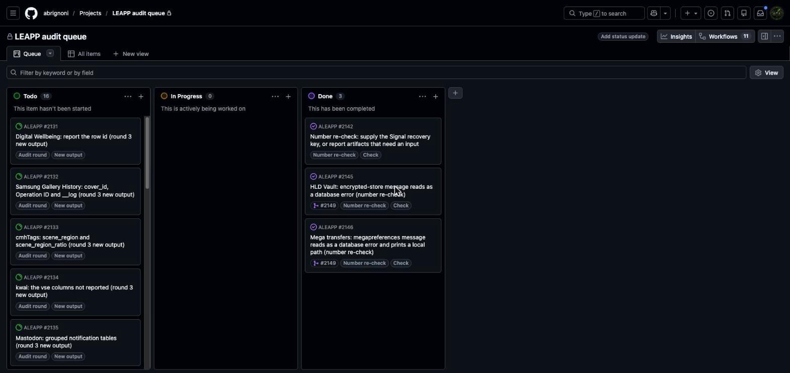

*Figure 10. The Queue view.*

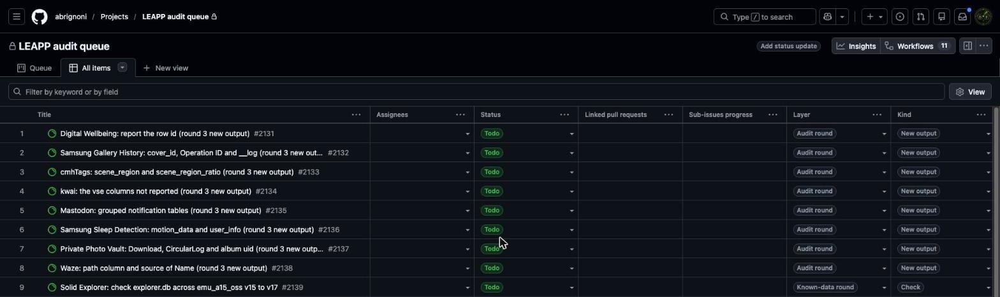

*Figure 11. The All items view, with the Layer and Kind fields. Cropped to the first nine rows.*

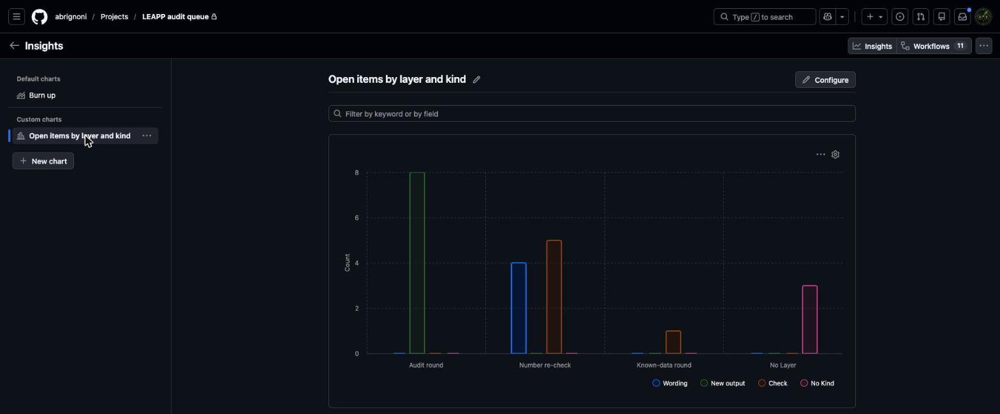

*Figure 12. Open items by layer and kind.*

> **For examiners.** The board is private, but the issues are not. The `audit-queue` label in each repo shows the public part of what is known to be missing from an artifact. Items that point at private corpus material are kept off GitHub.

## 8. What the person does, and what stays automatic

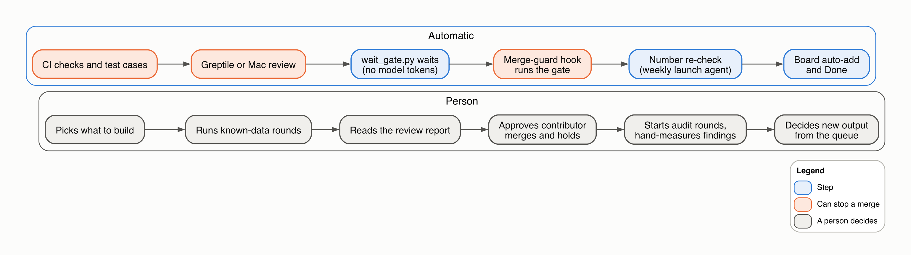

*Figure 13. The two lanes.*

| Step | Who or what | Can it block a merge? |
|---|---|---|
| Pick what to build, run known-data rounds | Person | No |
| Build with the skill, run on real data | Person, often with an agent | No |
| Lint, checkers, test cases | CI | Yes |
| Notes auditor before the PR | Agent, findings resolved by the author | Not by itself |
| Greptile or Mac review | Automatic, on every push | Yes, above the bar |
| Read the Mac report, approve contributor PRs and holds | Person | Yes |
| Merge | Gate plus the merge-guard hook | Yes |
| Audit rounds | Started by hand, run by agents, measured by a person | No |
| Re-checks and watches | Scheduled scripts | No |
| Decide new output from the queue | Person | No |

The rule I keep coming back to: automation measures and waits, a person decides.

## If you want to copy this

If I were starting on another tool, I would copy three pieces first:

1. A `sample_data`-style record of which real images each parser was run against, with row counts, plus a registry that says which images may be named in public.
2. A test-case harness that compares rows against committed baselines, so a parser change shows its row diff in the PR.
3. A written merge bar, so a review finding either blocks for a stated reason or becomes one issue and a reply.

The rest sits on top of those three, and the kit has the code for it.

What this does not do: it does not prove an artifact is correct on data nobody has seen. It shows what was run, on what, and what came back. That is all a report should claim, too.

## Closing

Back to where this started. An artifact's notes end up in someone's report, and that report can end up in front of a judge. Every layer in this post is there to make the sentences in that report more likely to be true, and to say so plainly when we do not know.

None of the layers is clever on its own. A check catches one kind of mistake, a reviewer catches another, and an audit finds what both missed years ago. Stacked, like the sieves at the top of this post, they catch more than any one of them would. Automation does the reading at a scale no one person can keep up with, and people decide what goes in the report.

The LEAPPs have always been a community project. Many of the artifacts these audits go back over were written by contributors who gave their time to the field, and the audits are how we keep that work trustworthy as the apps and the tools change around it. The kit is public so anyone maintaining a tool, LEAPP or not, can take what helps and leave the rest. If you build something better, send me a PR or two.
